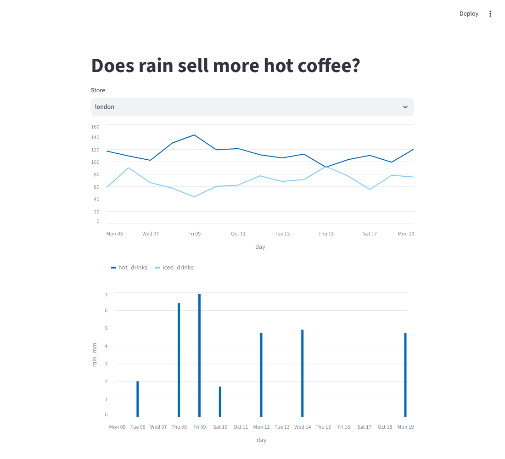
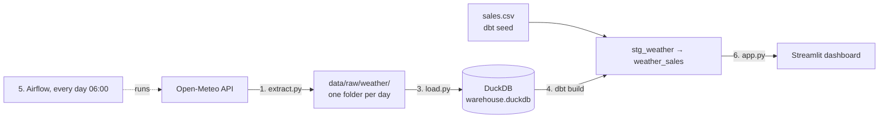

# weather-pipeline

**Does rain sell more hot coffee?** A beginner-friendly, end-to-end data engineering project that answers that question with free, open-source tools that run on your laptop.

This is the code from **Data Engineering Explained, Part 3: Build Your First Data Pipeline** by @dataengineeringlife. Watch the video for the why, then use this repo for the how.



*The dashboard after a two-week backfill (sales are sample data).*

## What it does



| Step | Tool | File | What happens |
|---|---|---|---|
| 1. Extract | Python + [Open-Meteo](https://open-meteo.com/) | `extract.py` | Calls the free weather API for each city, for one date |
| 2. Land | A folder (your "data lake") | `extract.py` | Saves the raw JSON untouched in `data/raw/weather/date=YYYY-MM-DD/` (the bronze layer) |
| 3. Load | DuckDB | `load.py` | Reads every JSON file into the `raw.weather` table with one SQL statement |
| 4. Transform | dbt | `dbt/` | `stg_weather` (silver) unpacks the API lists, `weather_sales` (gold) joins weather with sales, tests check the result |
| 5. Orchestrate | Airflow | `dags/weather_pipeline.py` | Runs everything every morning at 06:00, retries failures, can backfill missed days |
| 6. Serve | Streamlit | `app.py` | The dashboard: hot vs iced drinks per store, with rainfall underneath |

## Project structure

```
weather-pipeline/
├── extract.py                  # step 1 + 2: API → raw JSON files
├── load.py                     # step 3: raw files → DuckDB
├── app.py                      # step 6: Streamlit dashboard
├── dags/
│   └── weather_pipeline.py     # step 5: the Airflow DAG
├── dbt/                        # step 4
│   ├── dbt_project.yml
│   ├── profiles.yml            # points dbt at ../warehouse.duckdb
│   ├── models/
│   │   ├── sources.yml
│   │   ├── staging/stg_weather.sql
│   │   └── marts/weather_sales.sql, schema.yml
│   └── seeds/sales.csv         # sample sales export (generated)
├── scripts/
│   ├── backfill.py             # fetch the last N days in one go
│   └── make_sample_sales.py    # fake sales data so the project runs for anyone
├── docker-compose.override.yaml  # makes the official Airflow Docker setup run this project
├── requirements.txt
└── .gitignore                  # data/ and warehouse.duckdb are rebuilt, never committed
```

## What you need

- **Python 3.10 to 3.13** ([python.org](https://www.python.org/downloads/)). Check with `python3 --version`.
- **Git**.
- **For Airflow (step 5) only:** either Mac, Linux or Windows with [WSL](https://learn.microsoft.com/windows/wsl/install) (Airflow doesn't run natively on Windows), or [Docker Desktop](https://www.docker.com/products/docker-desktop/) with at least 4 GB of memory for it.

No accounts, API keys or cloud bills. Open-Meteo is free without a key for non-commercial use.

## Quick start (steps 1 to 4 and 6, about 5 minutes)

```bash
# 1. Get the code
git clone https://github.com/<your-username>/weather-pipeline.git
cd weather-pipeline

# 2. Create a virtual environment and install the packages
python3 -m venv .venv
source .venv/bin/activate          # Windows (PowerShell): .venv\Scripts\Activate.ps1
pip install -r requirements.txt
```

On Windows, use `python` instead of `python3`, and the same commands otherwise.

### Step 1 + 2: extract and land the raw data

Fetch one day:

```bash
python extract.py 2026-10-19
```

Or fetch the last 14 days so the dashboard has some history:

```bash
python scripts/backfill.py
```

You'll see files appear in `data/raw/weather/date=.../london.json` and `new_york.json`. Run the same day twice and the file is overwritten, so there are no duplicates.

### Step 3: load into DuckDB

```bash
python load.py
```

This creates `warehouse.duckdb` (the whole warehouse is that one file) with a `raw.weather` table.

### Sales data

A real coffee shop would export its sales from the till. We don't have one, so this script fakes a sales export for every day you have weather for (rainy days sell more hot drinks, hot days more iced coffee):

```bash
python scripts/make_sample_sales.py
```

It writes `dbt/seeds/sales.csv`. Swap in a real CSV with the same columns (`day,city,hot_drinks,iced_drinks`) any time.

### Step 4: transform with dbt

```bash
cd dbt
dbt build
cd ..
```

`dbt build` loads the seed, builds `stg_weather` and `weather_sales`, and runs the tests. You should see `PASS=5` and `Completed successfully`.

Optional: `cd dbt && dbt docs generate && dbt docs serve` opens a lineage graph of the models in your browser.

### Step 6: the dashboard

```bash
streamlit run app.py
```

It opens at http://localhost:8501. Pick a store and compare hot drinks against the rain.

## Step 5: run it every morning with Airflow

You've now run the pipeline by hand. Airflow runs it for you at 06:00 every day: extract → load → sample_sales → dbt_build. Pick **one** of the two options.

> The DAG has a fourth task, `sample_sales`, that the video doesn't show. It regenerates the fake sales export so each new day has sales to join with. With real sales data you'd replace it with whatever drops in your CSV.

### Option A: Airflow standalone (Mac, Linux, WSL)

Airflow gets its own virtual environment, because it pins many package versions. Its tasks still use your project's `.venv`.

```bash
# from the weather-pipeline folder
python3 -m venv .venv-airflow
source .venv-airflow/bin/activate

AIRFLOW_VERSION=3.1.8
PYTHON_VERSION="$(python -c 'import sys; print(f"{sys.version_info.major}.{sys.version_info.minor}")')"
pip install "apache-airflow==${AIRFLOW_VERSION}" \
  --constraint "https://raw.githubusercontent.com/apache/airflow/constraints-${AIRFLOW_VERSION}/constraints-${PYTHON_VERSION}.txt"
deactivate

# point Airflow at this project, and put the project's .venv first so tasks find python and dbt
export AIRFLOW_HOME="$(pwd)/.airflow"
export AIRFLOW__CORE__DAGS_FOLDER="$(pwd)/dags"
export AIRFLOW__CORE__LOAD_EXAMPLES=False
export PATH="$(pwd)/.venv/bin:$PATH"

.venv-airflow/bin/airflow standalone
```

Open http://localhost:8080 and log in with the username and password printed in the terminal (they're also saved in `.airflow/`). Find `weather_pipeline`, switch it on, and press ▶ to trigger a run.

To test the whole DAG once from the command line, without the web UI:

```bash
.venv-airflow/bin/airflow dags test weather_pipeline 2026-10-19
```

### Option B: Docker (any OS with Docker Desktop)

1. Download the official Airflow compose file into the project folder:

   ```bash
   curl -LfO 'https://airflow.apache.org/docs/apache-airflow/3.1.8/docker-compose.yaml'
   ```

   (Windows PowerShell: `Invoke-WebRequest -Uri https://airflow.apache.org/docs/apache-airflow/3.1.8/docker-compose.yaml -OutFile docker-compose.yaml`)

2. On Mac or Linux, tell Airflow your user id so files it writes belong to you:

   ```bash
   echo "AIRFLOW_UID=$(id -u)" > .env
   ```

3. Start it:

   ```bash
   docker compose up airflow-init
   docker compose up -d
   ```

Docker Compose automatically merges `docker-compose.override.yaml`, which mounts this project into the containers, sets `PROJECT_DIR`, installs `requests duckdb dbt-duckdb`, and hides the example DAGs. The first start takes a few minutes while it installs those packages.

Open http://localhost:8080 (user `airflow`, password `airflow`), switch on `weather_pipeline` and trigger it. Stop everything with `docker compose down`.

### Backfills

The DAG passes each run its own date (`{{ ds }}`) to `extract.py`, so you can fill in missed days:

```bash
airflow backfill create --dag-id weather_pipeline --from-date 2026-10-12 --to-date 2026-10-18
# Docker: docker compose run --rm airflow-cli airflow backfill create --dag-id weather_pipeline --from-date 2026-10-12 --to-date 2026-10-18
```

## Three beginner mistakes this project avoids

1. **Hardcoding today's date.** `extract.py` takes the date as an input, so backfills work.
2. **Appending instead of overwriting.** Each day writes its own folder, and `load.py` rebuilds `raw.weather` from the files, so running a day twice never doubles the numbers.
3. **API keys in your code.** Open-Meteo needs no key, but if you swap in an API that does, read it with `os.environ["API_KEY"]` and keep it in a `.env` file (already in `.gitignore`).

## Troubleshooting

- **`IO Error: Could not set lock on file "warehouse.duckdb"`**: DuckDB allows one writer at a time. Close anything holding the file (a notebook, a DuckDB CLI session) and run again. The dashboard opens it read-only and closes it straight away, so it can stay running.
- **`dbt: command not found`**: activate the virtual environment first (`source .venv/bin/activate`).
- **dbt can't find the profile**: run `dbt build` from inside the `dbt/` folder, where `profiles.yml` lives.
- **The dashboard says `weather_sales` doesn't exist**: run steps 1 to 4 first.
- **Empty charts**: you have weather but no matching sales. Run `python scripts/make_sample_sales.py`, then `cd dbt && dbt build`.
- **Airflow task fails with `python: command not found`** (Option A): make sure you exported the `PATH` line before starting Airflow.

## Ideas to take it further

- Add more cities to `CITIES` in `extract.py` (and to the `accepted_values` test).
- Pull more daily variables from Open-Meteo, like `apparent_temperature_max` or `sunshine_duration`.
- Move it to the cloud: land files in S3 or Google Cloud Storage, and swap DuckDB for BigQuery or Snowflake. The steps stay the same.
- Write a short "Decisions" section in your own README, like why you keep the raw files. Recruiters read that part.

## Credits

Weather data by [Open-Meteo.com](https://open-meteo.com/) (CC BY 4.0, free for non-commercial use). The sales figures are randomly generated sample data.

Made for the **Data Engineering Explained** series by @dataengineeringlife. Built it? Share your repo in the video's comments.
